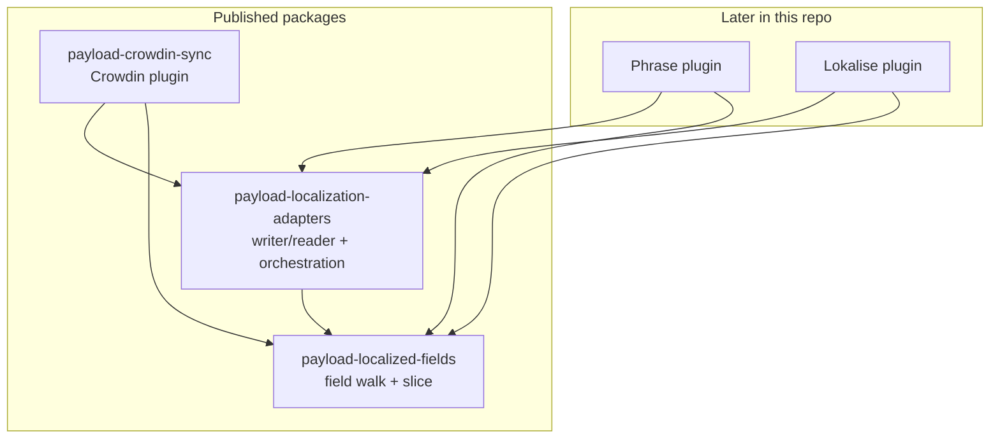
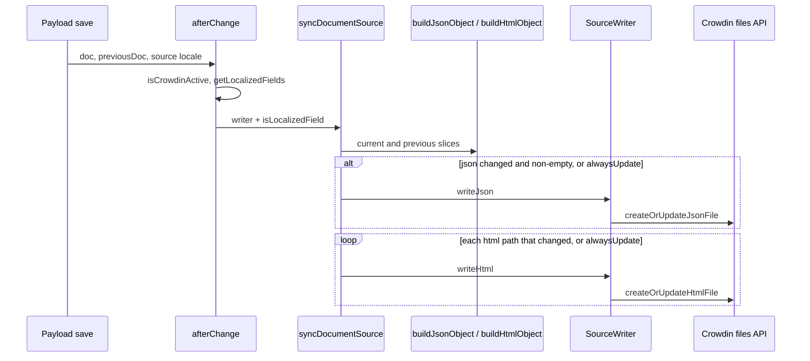
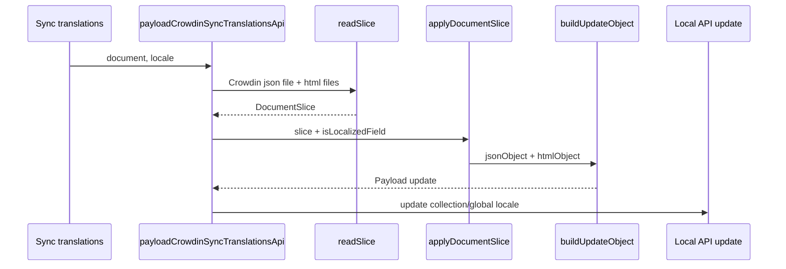

# Packages

The repo publishes three npm packages. Crowdin is one consumer. Phrase and Lokalise plugins, when they exist here, should depend on the first two and not on `payload-crowdin-sync`.

| Folder | npm name | Job |
| --- | --- | --- |
| `document/` | `payload-localized-fields` | Walk a Payload field schema. Split a document into a json/html **slice**, and merge a slice back into a Payload update. |
| `adapters/` | `payload-localization-adapters` | `SourceWriter` / `TranslationReader` contracts, plus `syncDocumentSource` / `applyDocumentSlice`. |
| `plugin/` | `payload-crowdin-sync` | Crowdin folders and files, Lexical/Slate HTML, article directories, admin UI. Re-exports the adapter functions. |

`dev/` and `docs-site/` are not published.



Crowdin is the only vendor plugin today. A vendor plugin depends on both adapters and localized-fields. A second vendor must not import `payload-crowdin-sync` to get the walk or the slice.

## The slice

A **document slice** is not a Crowdin file and not HTML yet. It is Payload-shaped localized content for one document, split for a translation tool:

- **json** — nested strings (groups as objects; array/block items keyed by Payload `id`).
- **html** — rich-text **editor JSON** (Slate or Lexical), keyed by dotted path such as `body` or `items.<id>.copy`.

`payload-localized-fields` builds that slice (`buildJsonObject` / `buildHtmlObject`) and turns one back into a Payload update (`buildUpdateObject`). Array and block order is restored only when the current `document` is passed; `applyDocumentSlice` forwards that argument when it is set. It does not convert Lexical or Slate to HTML. That conversion is Crowdin-specific and lives in the plugin.

Crowdin then stores json as `fields.json` and each html path as a `.html` file. Phrase or Lokalise can flatten the same slice into keys instead.

Per-field uploads with unique names would work. The slice is how we batch API calls, HTML-round-trip rich text and nested blocks, and keep Crowdin folders tidy. See [engineering decisions](./engineering.md#why-a-document-slice-not-field-hooks).

## Upload (source locale save)



The Crowdin hook in `plugin/src/lib/hooks/collections/afterChange.ts` is the vendor side: directories, `filesApiByDocument`, `custom.crowdinSync.disable`. `syncDocumentSource` only diffs slices and calls the writer.

## Download (sync translations)



`readSlice` is Crowdin's `TranslationReader`. `applyDocumentSlice` is a thin wrap of `buildUpdateObject`. HTML strings from Crowdin are converted back to Slate/Lexical in the plugin **before** they become slice `html` values (or during `getTranslation`, depending on the file type).

## What stays in the Crowdin plugin

Anything that names Crowdin or an editor HTML dialect:

- Collection/article directories and `crowdin-files`
- `createOrUpdateJsonFile` / `createOrUpdateHtmlFile`
- Lexical block subfolders (`lex.*`) and `blocks.json`
- Slate `@slate-serializers/html` and Lexical `convertLexicalToHTML` / `convertHTMLToLexical`
- `isLocalizedField` wrapping `custom.crowdinSync.disable` and the admin-description exclude
- Virtual "Sync translations" fields and review/update endpoints

`plugin/src/lib/utilities/index.ts` still exports Crowdin wrappers (`buildCrowdinJsonObject` and friends) that default `isLocalized` to that Crowdin predicate so existing plugin call sites stay short.

## `isLocalized`

`payload-localized-fields` defaults to Payload's idea of a localizable leaf (`text`, `textarea`, `richText`, plus children of a localized parent).

Crowdin extra rules are a predicate passed in:

```ts
isLocalized: isLocalizedField  // plugin wrapper, not the document package default
```

A Phrase plugin would pass its own wrapper. The shared walk must not import `custom.crowdinSync`.

## Finding the code

| Concern | Start here |
| --- | --- |
| Field walk, json/html slice | `document/src/` |
| Diff, skip empty json, apply slice | `adapters/src/` |
| Crowdin afterChange writer | `plugin/src/lib/hooks/collections/afterChange.ts` |
| Crowdin `readSlice` / apply | `plugin/src/lib/api/translations.ts` |
| Crowdin file CRUD | `plugin/src/lib/api/files/` |
| Lexical blocks as nested "documents" | `plugin/src/lib/api/files/lexical-blocks.ts` |
| Rich-text HTML | `plugin/src/lib/utilities/richTextConversion.ts` |
